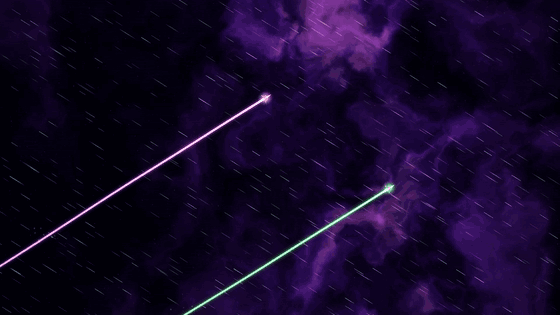
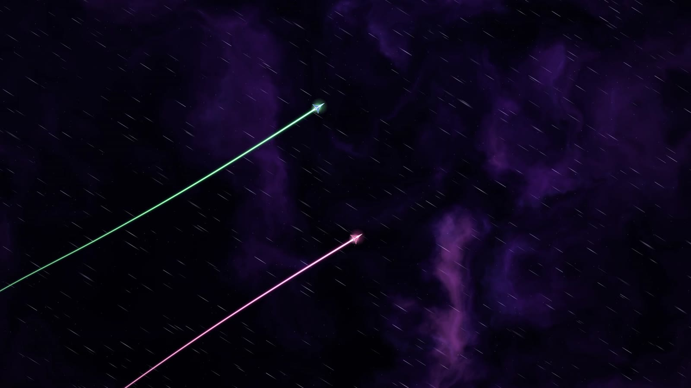
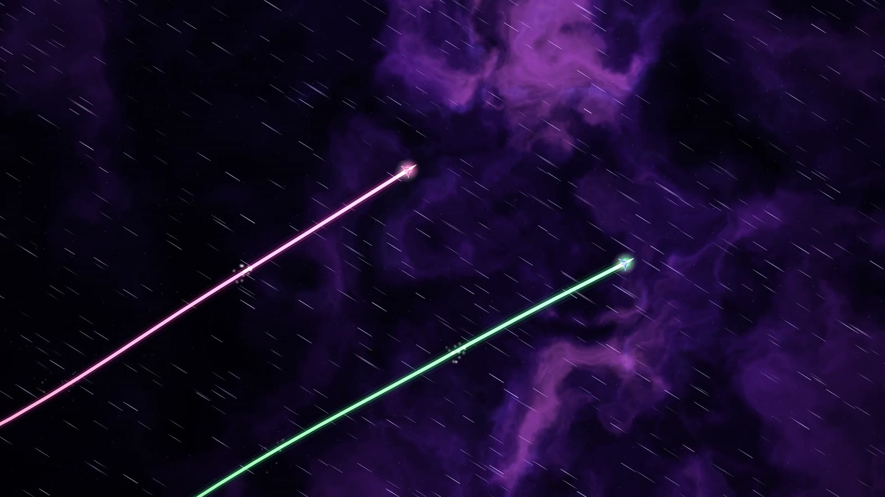
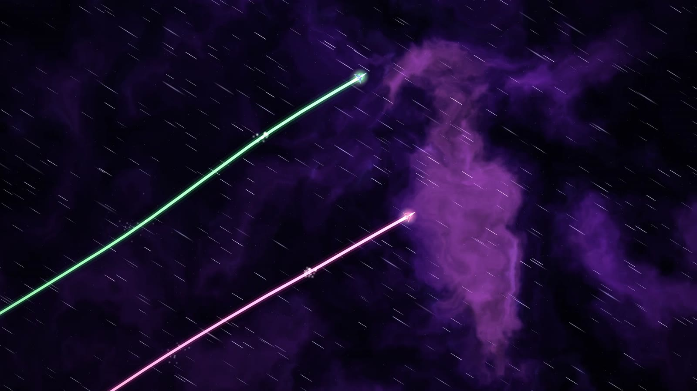
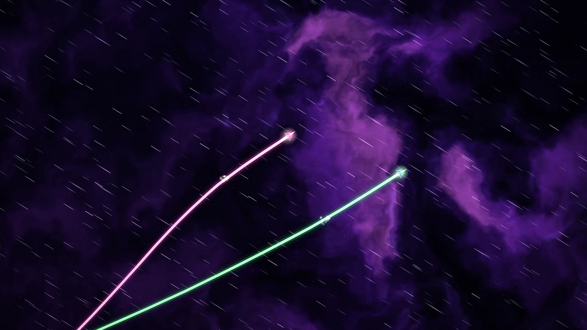

# SpaceWall Ships

🇬🇧 [English](README.md) · 🇫🇷 Français

**Fonctionne sur : 🐧 Linux (KDE Plasma 5) · 🪟 Windows 10/11 (expérimental)**

<p align="center"></p>

Un fond d'écran animé qui réagit au son : une nébuleuse violette, une pluie qui tombe et deux petits vaisseaux dont les mouvements suivent votre musique.
Il réagit à tout ce que votre ordinateur joue (Spotify, YouTube, jeux...), fonctionne en local et ne coûte rien.

| 🪟 **Windows 10/11** (expérimental) | 🐧 **Linux avec KDE Plasma 5** |
|---|---|
| **[Téléchargez le zip](https://github.com/dghAyoub/spacewall-ships/releases/tag/windows-v0.1.0)**, extrayez-le, double-cliquez sur `1-RUN-ALL-TESTS.bat`. [Détails](#windows-expérimental) | `git clone` + `./install.sh`. [Détails](#installation-sous-linux) |

- Musique calme : les vaisseaux dérivent en parallèle. Plus fort : ils changent de voie, se croisent et font des tonneaux.
- La hauteur du son règle l'écart entre les vaisseaux ; les basses les poussent vers l'avant ; les accents de caisse claire ou de voix font sauter un vaisseau ; les charleys déclenchent les tonneaux.
- Un petit bouton marche/arrêt (un bouton du panneau sous KDE, une icône de la zone de notification sous Windows) éteint complètement l'animation.

## Aperçu
| | |
|---|---|
| <br>Un passage calme : faisceaux fins et ternes, pluie légère | <br>La musique monte : les faisceaux deviennent plus brillants |
| <br>Le passage fort : faisceaux brillants et épais, pluie dense | <br>Les vaisseaux se croisent et échangent leurs côtés |

Vidéo en pleine qualité (24 s, 1280x720, sans son) : d'un passage calme au passage fort, avec un croisement. Vous pouvez aussi la télécharger : [`docs/preview.mp4`](docs/preview.mp4).

https://github.com/user-attachments/assets/100434ff-8826-4404-b3cd-d09c924d0569

L'aperçu a été enregistré avec un morceau de démonstration original généré par ordinateur : ce dépôt ne contient donc aucune musique protégée.

## Windows (expérimental)
Un petit programme Windows à part entière (sans Lively ni autre application) : la même animation derrière vos icônes du bureau, qui écoute vos haut-parleurs, avec une icône dans la zone de notification pour l'allumer et l'éteindre.
- **Téléchargement :** [`SpaceWall-Windows-v0.1.0.zip`](https://github.com/dghAyoub/spacewall-ships/releases/tag/windows-v0.1.0) (68 Mo, sur la page des Releases).
- Extrayez **tout** le zip dans un dossier, puis double-cliquez sur `1-RUN-ALL-TESTS.bat`. Le premier lancement teste votre PC et choisit la meilleure façon de se placer derrière les icônes. Le programme n'est pas signé : si Windows affiche « Windows a protégé votre ordinateur », cliquez sur **Informations complémentaires**, puis **Exécuter quand même**.
- **Testé sur un seul PC :** Windows 10 Pro 22H2, Intel HD 620, audio Realtek. Non testé : Windows 11, d'autres cartes graphiques, plusieurs écrans, « Démarrer avec Windows » après un redémarrage. En cas de problème, l'icône a un élément « Diagnostic », et le journal est dans `%APPDATA%\SpaceWall\log.txt`.
- Mode d'emploi : [`windows/README-WINDOWS.fr.txt`](windows/README-WINDOWS.fr.txt). Code source (C#, .NET 8, WebView2) : [`windows/src`](windows/src).

## Prérequis (Linux)
- Ubuntu 24.04 ou plus récent **avec KDE Plasma 5** (Kubuntu, ou Ubuntu avec `kde-plasma-desktop`), ou Linux Mint 22 avec KDE. Il a été conçu sur Plasma **5.27**.
- **Non pris en charge :** GNOME, Plasma 6, Windows, macOS.
- Paquets (l'installateur les vérifie) : `python3 pulseaudio-utils xdotool x11-utils iproute2 qdbus-qt5 libkf5service-bin qml-module-qtwebengine`
  (`pulseaudio-utils` fonctionne aussi avec PipeWire).

## Installation sous Linux
```bash
git clone https://github.com/dghAyoub/spacewall-ships.git
cd spacewall-ships
./install.sh --install-deps     # --install-deps demande votre mot de passe sudo pour installer les paquets manquants
```
Autres options : `--no-activate` (copie tout mais garde votre fond d'écran actuel), `--no-start`, `--no-plasma`.
L'installation se fait dans `~/SpaceWall-ships` : elle ajoute le module de fond d'écran Plasma et le bouton du panneau, et lance un pont audio à chaque ouverture de session.

Le tout premier passage au nouveau fond d'écran peut faire un flash blanc d'environ 2 secondes : Plasma charge son moteur web. Ensuite, l'allumer et l'éteindre ne fait plus de flash.

## Utilisation (Linux)
- Cliquez sur la petite icône de fond d'écran avec un point dans votre barre du haut (vert = allumé, gris = éteint). Elle peut se trouver tout à gauche de la barre ; déplacez-la avec *Modifier le panneau*.
- Votre choix (allumé/éteint) est gardé après un redémarrage.
- L'image affichée quand l'animation est éteinte est `~/SpaceWall-ships/assets/wallpaper-off.png`. Remplacez-la par l'image 1920x1080 de votre choix, puis éteignez et rallumez le module de fond d'écran.
- Revenir à votre ancien fond d'écran : `~/SpaceWall-ships/normal-wallpaper.sh`. Repasser à SpaceWall : `~/SpaceWall-ships/spacewall-wallpaper.sh`.
- Les réglages se trouvent en haut de `~/SpaceWall-ships/index.html` (`FPS` par défaut 30, `SENS` sensibilité, `BGS`/`NEBS` qualité). Modifiez, puis éteignez et rallumez.

## Désinstallation (Linux)
```bash
./uninstall.sh
```

## Bon à savoir (Linux)
- **Processeur :** la page d'animation utilise environ 25 à 30 % d'un cœur sur un vieux portable à 2 cœurs quand elle est allumée, et 0 % quand elle est éteinte. Baissez `FPS` dans `index.html` si vous voulez moins.
- **Icône de microphone :** quand l'animation est allumée, KDE affiche son icône de microphone. Ce n'est pas votre microphone : le pont enregistre la *sortie de vos haut-parleurs* (le « moniteur » de la sortie son par défaut) pour entendre la musique. L'icône disparaît quand vous éteignez l'animation.
- **Pause en plein écran** (l'animation se met en pause sous un jeu ou une vidéo en plein écran) : nécessite une session X11. Sous Wayland, tout le reste fonctionne.
- **Si vous modifiez le QML du module**, Plasma le garde en mémoire jusqu'au redémarrage de plasmashell : `kquitapp5 plasmashell; setsid nohup plasmashell >/dev/null 2>&1 &`. Les changements dans `index.html` et dans l'image n'en ont pas besoin.
- **Rien n'est envoyé nulle part.** Le pont n'écoute que sur `127.0.0.1:8777`.
- Pas de réaction au son ? Vérifiez que la musique passe par la sortie *par défaut* et que `parec` fonctionne : `parec -d @DEFAULT_MONITOR@ --format=s16le | head -c 100 | wc -c`.

## Licence
MIT, voir `LICENSE`.

Créé avec l'aide d'un assistant IA (Claude).
